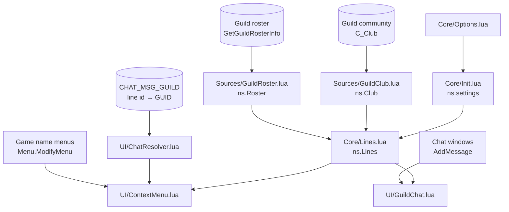

# GuildLens architecture

**English** · [Русский](ARCHITECTURE.ru.md) · [README](../README.md)

How the addon is put together: where its data comes from, how a name menu learns which guild member it is about, and
how guild chat gets its tag. For setting up the repository and running the checks, see
[CONTRIBUTING.md](../CONTRIBUTING.md).

## Principles

- **Only what the client knows.** The guild roster and the guild's community (`C_Club`). Nothing is sent, no addon
  messages, nothing about guild members is saved.
- **Add, don't change.** The lines go after the game's own menu items, as titles that can't be clicked. An error in
  GuildLens is reported and the menu opens as usual.
- **Nothing known, nothing shown.** A field the client doesn't give is left out.
- **Cheap on busy guilds.** The client sends `GUILD_ROSTER_UPDATE` many times a minute in a large guild; the caches are
  only marked stale then and rebuilt when a menu needs them.

## Modules

The files load in the order the TOC lists them. Each one is a module on the shared addon namespace
(`local _, ns = ...`) and may use only the modules loaded before it.

| File | Module | What it does |
| --- | --- | --- |
| `Libs/Libs.xml` | — | Ace3: LibStub, CallbackHandler, AceGUI, AceConfig (options window only). |
| `Core/Init.lua` | `ns.L`, `ns.settings`, `ns.db`, `ns.OnLogin` | Namespace, string table, saved settings, login callbacks. |
| `Locales/enUS.lua`, `ruRU.lua` | fills `ns.L` | The addon's own text; in Russian also rank and female race names. |
| `Core/Commands.lua` | `ns.AddCommand` | `/glens` and `/guildlens` with their subcommands. |
| `Sources/GuildRoster.lua` | `ns.Roster` | The guild roster by name and GUID; `/glens status`. |
| `Sources/GuildClub.lua` | `ns.Club` | The guild community's member info: race, professions. |
| `UI/ChatResolver.lua` | `ns.ChatResolver` | Which guild member a menu is about. |
| `Core/Lines.lua` | `ns.Lines` | The lines about a member, and the guild chat tag. |
| `UI/ContextMenu.lua` | `ns.ContextMenu` | Adds the lines to the game's name menus; `/glens debug`. |
| `UI/GuildChat.lua` | `ns.GuildChat` | Replaces `[Guild]` in guild chat lines with the sender's tag. |
| `Core/Options.lua` | `ns.options`, `ns.OpenOptions` | The options window. |

## Start-up

1. `ADDON_LOADED` for GuildLens: the saved variable `GuildLensDB` becomes `ns.settings` (and `ns.db`), with defaults
   for missing keys: every menu line on, every guild chat part off.
2. `PLAYER_LOGIN`: every callback registered with `ns.OnLogin` runs, in load order: the menus are hooked, the chat
   windows' `AddMessage` is wrapped, the options window is registered.

## The roster

`ns.Roster` keeps every member of `GetGuildRosterInfo` by full name, by name without `-Realm` and by GUID, with the
time since they were last online (`GetGuildRosterLastOnline`). `GUILD_ROSTER_UPDATE` and `PLAYER_GUILD_UPDATE` only
mark the cache stale; `Roster.Find(name, guid)` rebuilds it first when it is. `Roster.Request()` asks the server for a
fresh roster, at most once in 30 seconds; a menu opening calls it, so the next one is up to date.

`ns.Club` maps GUIDs to the guild community's member ids (`C_Club.GetClubMembers`), rebuilt only when members come
and go, and asks `C_Club.GetMemberInfo` fresh on each lookup. It gives the race id and the two professions (names
only: the skill is not there). Clients without `C_Club` get nothing from it.

## Which member a menu is about

`ChatResolver.Resolve(context)` gets the context of the menu being opened and returns the member's name and GUID, or
nothing when the menu isn't about a guild member:

- A name in guild chat opens the `FRIEND` menu with `chatType = "GUILD"` (or `"OFFICER"`) and the line's id, but no
  GUID. The resolver keeps the GUID of the last 500 guild chat lines from `CHAT_MSG_GUILD` / `CHAT_MSG_OFFICER`
  (argument 12 by argument 11) and looks it up by the line id.
- The guild window's member list opens `COMMUNITIES_GUILD_MEMBER` (or `GUILD`, `GUILD_OFFLINE`) with the GUID.
- A name in the guild window's own chat opens a community member menu whose club id is the guild's
  (`C_Club.GetGuildClubId()`).

Names in other channels and in whispers are left alone.

## The lines

`Lines.ForName(name, guid)` finds the member and builds the lines (`Lines.ForMember`), or says the roster isn't loaded
yet or the name isn't in it. Each line but the first is turned on by its own setting:

| Line | Setting | From |
| --- | --- | --- |
| Class icon, class in its colour, level | `menuIcon` (the icon) | roster, `CLASS_ICON_TCOORDS`, `RAID_CLASS_COLORS` |
| Race (and sex) | `menuRace` | see below |
| Rank | `menuRank` | roster; the default rank names through `ns.RankNames` |
| Status, or when last seen | `menuStatus` | roster |
| Zone | `menuZone` | roster |
| Professions | `menuProfessions` | `ns.Club` |
| Note | `menuNote` | roster (public note) |

Race: `GetPlayerInfoByGUID` gives the race named by sex, but only for characters the client has met. Otherwise the race
comes from the community (`C_CreatureInfo.GetRaceInfo`), and the sex from the roster's class name where the language
names classes by sex (a female hunter is "Охотница" in Russian): `LOCALIZED_CLASS_NAMES_FEMALE`. The female race name
then comes from `ns.FemaleRaceNames` of the locale; English shows "Night Elf, female".

Text uses only characters the game's fonts have: the Russian font has no "·", so parts are joined with ", ".

## The menus

`UI/ContextMenu.lua` hooks the menus with `Menu.ModifyMenu` (`MENU_UNIT_FRIEND`, `MENU_UNIT_COMMUNITIES_GUILD_MEMBER`,
`MENU_UNIT_GUILD`, `MENU_UNIT_GUILD_OFFLINE`, `MENU_UNIT_COMMUNITIES_MEMBER`, `MENU_UNIT_COMMUNITIES_WOW_MEMBER`). For a
guild member it adds a divider and the lines as titles at the end of the menu, inside `pcall`: an error goes to the
game's error handler and the menu opens anyway.

`/glens debug` records the context of the last 10 menus into `GuildLensDB.debugMenus`, to see what a menu that shows
nothing carries. It holds players' names, so it is off unless turned on, and turning it off forgets them.

## Guild chat

`UI/GuildChat.lua` wraps `AddMessage` of each chat window. In a line with the guild channel's link
(`|Hchannel:GUILD|h[Guild]|h`) it replaces the link's text with `Lines.ChatTag`: the parts ticked in the options
(`chatIcon`, `chatLevel`, `chatZone`) of the sender, who is read from the line's player link. The link itself stays, so
a click on the tag still starts a reply in guild chat. Left as they are: other channels (officer chat too), senders
not in the roster, and text the client keeps from addons (`issecretvalue` on modern clients). With no part ticked,
nothing is replaced.

## Checks

- `tests/check_syntax.py` — every Lua file parses.
- `tests/smoke.py enUS|ruRU` — loads the files in TOC order against stubbed game APIs twice: as a modern client
  (`Menu`, `C_GuildInfo`, `C_Club`) and as an older one, and checks the lines, the menus and the chat tag.
- `tools/release_check.py` — both TOC files have the same version and `CHANGELOG.md` has a section for it.
