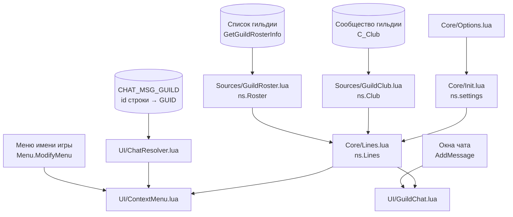

# Архитектура GuildLens

[English](ARCHITECTURE.md) · **Русский** · [README](../README.ru.md)

Как устроен аддон: откуда берутся данные, как меню имени узнаёт, о каком участнике гильдии оно, и откуда метка в чате
гильдии. Как настроить репозиторий и запустить проверки — в [CONTRIBUTING.md](../CONTRIBUTING.md).

## Принципы

- **Только то, что знает клиент.** Список гильдии и сообщество гильдии (`C_Club`). Ничего не отправляется, никаких
  сообщений аддонов, данные участников не сохраняются.
- **Добавлять, а не менять.** Строки идут после обычных пунктов меню, как заголовки, по которым нельзя щёлкнуть.
  Ошибка в GuildLens сообщается, а меню открывается как обычно.
- **Нет данных — нет строки.** Поле, которого клиент не даёт, просто не показывается.
- **Бережно к большим гильдиям.** В большой гильдии клиент шлёт `GUILD_ROSTER_UPDATE` много раз в минуту; кеши тогда
  только помечаются устаревшими и пересобираются, когда они нужны меню.

## Модули

Файлы загружаются в порядке TOC. Каждый — модуль в общем пространстве имён аддона (`local _, ns = ...`) и может
пользоваться только модулями, загруженными раньше.

| Файл | Модуль | Что делает |
| --- | --- | --- |
| `Libs/Libs.xml` | — | Ace3: LibStub, CallbackHandler, AceGUI, AceConfig (только окно настроек). |
| `Core/Init.lua` | `ns.L`, `ns.settings`, `ns.db`, `ns.OnLogin` | Пространство имён, строки, настройки, вызовы при входе. |
| `Locales/enUS.lua`, `ruRU.lua` | заполняют `ns.L` | Тексты аддона; в русском ещё ранги и женские названия рас. |
| `Core/Commands.lua` | `ns.AddCommand` | `/glens` и `/guildlens` с подкомандами. |
| `Sources/GuildRoster.lua` | `ns.Roster` | Список гильдии по имени и GUID; `/glens status`. |
| `Sources/GuildClub.lua` | `ns.Club` | Сведения сообщества гильдии об участнике: раса, профессии. |
| `UI/ChatResolver.lua` | `ns.ChatResolver` | О каком участнике гильдии меню. |
| `Core/Lines.lua` | `ns.Lines` | Строки об участнике и метка для чата гильдии. |
| `UI/ContextMenu.lua` | `ns.ContextMenu` | Добавляет строки в меню имени; `/glens debug`. |
| `UI/GuildChat.lua` | `ns.GuildChat` | Заменяет `[Гильдия]` в строках чата гильдии меткой отправителя. |
| `Core/Options.lua` | `ns.options`, `ns.OpenOptions` | Окно настроек. |

## Запуск

1. `ADDON_LOADED` для GuildLens: сохранённая переменная `GuildLensDB` становится `ns.settings` (и `ns.db`), со
   значениями по умолчанию для отсутствующих ключей: все строки меню включены, все части метки в чате выключены.
2. `PLAYER_LOGIN`: по порядку загрузки выполняются вызовы, зарегистрированные через `ns.OnLogin`: подключаются меню,
   оборачивается `AddMessage` окон чата, регистрируется окно настроек.

## Список гильдии

`ns.Roster` хранит каждого участника из `GetGuildRosterInfo` по полному имени, по имени без `-Сервер` и по GUID, вместе
с временем с последнего входа (`GetGuildRosterLastOnline`). `GUILD_ROSTER_UPDATE` и `PLAYER_GUILD_UPDATE` только
помечают кеш устаревшим; `Roster.Find(name, guid)` тогда сначала пересобирает его. `Roster.Request()` просит у сервера
свежий список не чаще раза в 30 секунд; его вызывает открытие меню, так что следующее будет актуальным.

`ns.Club` сопоставляет GUID с id участников сообщества гильдии (`C_Club.GetClubMembers`), пересобирая карту только
когда участники приходят и уходят, и при каждом обращении заново спрашивает `C_Club.GetMemberInfo`. Оттуда — id расы
и две профессии (только названия: уровня навыка там нет). Клиенты без `C_Club` ничего отсюда не получают.

## О каком участнике меню

`ChatResolver.Resolve(context)` получает контекст открываемого меню и возвращает имя и GUID участника — или ничего,
если меню не об участнике гильдии:

- Имя в чате гильдии открывает меню `FRIEND` с `chatType = "GUILD"` (или `"OFFICER"`) и id строки, но без GUID.
  Резолвер хранит GUID последних 500 строк чата гильдии из `CHAT_MSG_GUILD` / `CHAT_MSG_OFFICER` (аргумент 12 по
  аргументу 11) и находит его по id строки.
- Список участников окна гильдии открывает `COMMUNITIES_GUILD_MEMBER` (или `GUILD`, `GUILD_OFFLINE`) с GUID.
- Имя в чате внутри окна гильдии открывает меню участника сообщества, id клуба которого — id гильдии
  (`C_Club.GetGuildClubId()`).

Имена в других каналах и в шёпоте аддон не трогает.

## Строки

`Lines.ForName(name, guid)` находит участника и строит строки (`Lines.ForMember`) или сообщает, что список гильдии ещё
не загружен или имени в нём нет. Каждая строка, кроме первой, включается своей настройкой:

| Строка | Настройка | Откуда |
| --- | --- | --- |
| Иконка класса, класс его цветом, уровень | `menuIcon` (иконка) | список, `CLASS_ICON_TCOORDS`, `RAID_CLASS_COLORS` |
| Раса (и пол) | `menuRace` | см. ниже |
| Ранг | `menuRank` | список; стандартные названия рангов через `ns.RankNames` |
| Статус или когда заходил | `menuStatus` | список |
| Зона | `menuZone` | список |
| Профессии | `menuProfessions` | `ns.Club` |
| Заметка | `menuNote` | список (публичная заметка) |

Раса: `GetPlayerInfoByGUID` даёт расу в форме по полу, но только для персонажей, которых клиент встречал. Иначе раса
берётся из сообщества (`C_CreatureInfo.GetRaceInfo`), а пол — из названия класса в списке, если язык называет классы
по полу («Охотница»): `LOCALIZED_CLASS_NAMES_FEMALE`. Женское название расы тогда берётся из `ns.FemaleRaceNames`
локали; в английском — «Night Elf, female».

В тексте только символы, которые есть в шрифтах игры: в русском шрифте нет «·», поэтому части разделяются «, ».

## Меню

`UI/ContextMenu.lua` подключается к меню через `Menu.ModifyMenu` (`MENU_UNIT_FRIEND`,
`MENU_UNIT_COMMUNITIES_GUILD_MEMBER`, `MENU_UNIT_GUILD`, `MENU_UNIT_GUILD_OFFLINE`, `MENU_UNIT_COMMUNITIES_MEMBER`,
`MENU_UNIT_COMMUNITIES_WOW_MEMBER`). Для участника гильдии добавляет в конец меню разделитель и строки-заголовки, внутри
`pcall`: ошибка уходит в обработчик ошибок игры, а меню всё равно открывается.

`/glens debug` записывает контекст последних 10 меню в `GuildLensDB.debugMenus`, чтобы увидеть, что несёт меню, в
котором ничего не показалось. Там имена игроков, поэтому запись выключена, пока её не включить, а при выключении
стирается.

## Чат гильдии

`UI/GuildChat.lua` оборачивает `AddMessage` каждого окна чата. В строке со ссылкой канала гильдии
(`|Hchannel:GUILD|h[Гильдия]|h`) текст ссылки заменяется на `Lines.ChatTag`: отмеченные в настройках части (`chatIcon`,
`chatLevel`, `chatZone`) об отправителе, которого аддон узнаёт по ссылке игрока в строке. Сама ссылка остаётся, так что
щелчок по метке по-прежнему начинает ответ в чат гильдии. Не трогаются: другие каналы (и офицерский), отправители не из
списка гильдии и текст, который клиент скрывает от аддонов (`issecretvalue` в новых клиентах). Если ни одна часть не
отмечена, ничего не заменяется.

## Проверки

- `tests/check_syntax.py` — все файлы Lua разбираются.
- `tests/smoke.py enUS|ruRU` — загружает файлы в порядке TOC на заглушках игрового API дважды: как новый клиент
  (`Menu`, `C_GuildInfo`, `C_Club`) и как старый, и проверяет строки, меню и метку в чате.
- `tools/release_check.py` — версия в обоих TOC одна и та же, и в `CHANGELOG.md` есть раздел для неё.
